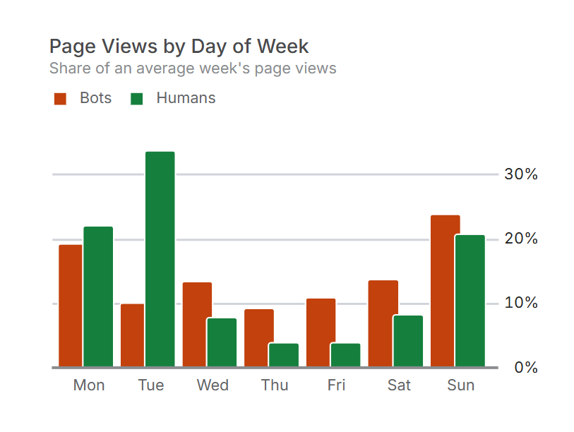

# Human Tuesdays

<svg viewBox="0 0 600 720" width="300" height="360" style="display:block; margin:0 auto;" xmlns="http://www.w3.org/2000/svg">
  <rect x="0" y="0" width="600" height="720" fill="#ffffff"/>
  <g fill="none" stroke="#1a1a1a" stroke-linecap="round" stroke-linejoin="round">
    <path d="M452,88 A46 46 0 1 0 452,178 A36 36 0 1 1 452,88 Z" stroke-width="2.0"/>
    <path d="M60,290 Q220,92 386,118" stroke-width="1.2" stroke-dasharray="2 7"/>
    <path d="M506,150 Q536,164 566,186" stroke-width="1.2" stroke-dasharray="2 7"/>
    <g stroke-width="1.0">
      <line x1="300" y1="64" x2="300" y2="84"/>
      <line x1="290" y1="74" x2="310" y2="74"/>
    </g>
    <g stroke-width="0.9">
      <line x1="540" y1="246" x2="540" y2="260"/>
      <line x1="533" y1="253" x2="547" y2="253"/>
      <line x1="150" y1="130" x2="150" y2="144"/>
      <line x1="143" y1="137" x2="157" y2="137"/>
    </g>
    <circle cx="210" cy="70" r="1.5" fill="#1a1a1a"/>
    <circle cx="520" cy="60" r="1.4" fill="#1a1a1a"/>
    <circle cx="380" cy="230" r="1.4" fill="#1a1a1a"/>
    <path d="M100,300 L342,298 L341,318 L101,319 Z" stroke-width="2.2"/>
    <path d="M114,319 C113,420 116,500 115,578" stroke-width="2.2"/>
    <path d="M326,318 C327,420 325,500 327,578" stroke-width="2.2"/>
    <g stroke-width="1.3">
      <path d="M115,362 C180,363 260,361 326,362"/>
      <path d="M115,406 C180,407 260,405 326,406"/>
      <path d="M115,450 C180,451 260,449 326,450"/>
      <path d="M115,494 C180,495 260,493 326,494"/>
      <path d="M115,538 C180,539 260,537 326,538"/>
      <line x1="190" y1="322" x2="191" y2="359"/>
      <line x1="270" y1="322" x2="271" y2="359"/>
      <line x1="150" y1="365" x2="151" y2="403"/>
      <line x1="230" y1="365" x2="231" y2="403"/>
      <line x1="300" y1="365" x2="301" y2="403"/>
      <line x1="180" y1="409" x2="181" y2="447"/>
      <line x1="260" y1="409" x2="261" y2="447"/>
      <line x1="145" y1="453" x2="146" y2="491"/>
      <line x1="215" y1="453" x2="216" y2="491"/>
      <line x1="290" y1="453" x2="291" y2="491"/>
      <line x1="190" y1="497" x2="191" y2="535"/>
      <line x1="265" y1="497" x2="266" y2="535"/>
      <line x1="190" y1="541" x2="191" y2="575"/>
      <line x1="270" y1="541" x2="271" y2="575"/>
    </g>
    <path d="M115,474 C200,476 300,472 470,475" stroke-width="1.2" stroke-dasharray="3 6"/>
    <circle cx="220" cy="404" r="58" fill="#ffffff" stroke-width="2.4"/>
    <circle cx="220" cy="404" r="50" stroke-width="1.2"/>
    <g stroke-width="1.3">
      <line x1="220" y1="366" x2="220" y2="356"/>
      <line x1="241.5" y1="366.8" x2="244" y2="362.4"/>
      <line x1="257.2" y1="382.5" x2="261.6" y2="380"/>
      <line x1="263" y1="404" x2="268" y2="404"/>
      <line x1="257.2" y1="425.5" x2="261.6" y2="428"/>
      <line x1="241.5" y1="441.2" x2="244" y2="445.6"/>
      <line x1="220" y1="442" x2="220" y2="452"/>
      <line x1="198.5" y1="441.2" x2="196" y2="445.6"/>
      <line x1="182.8" y1="425.5" x2="178.4" y2="428"/>
      <line x1="177" y1="404" x2="172" y2="404"/>
      <line x1="182.8" y1="382.5" x2="178.4" y2="380"/>
      <line x1="198.5" y1="366.8" x2="196" y2="362.4"/>
    </g>
    <line x1="220" y1="404" x2="251.8" y2="387.1" stroke-width="2.2"/>
    <line x1="220" y1="404" x2="211.2" y2="408.7" stroke-width="2.2"/>
    <circle cx="220" cy="404" r="3.4" fill="#1a1a1a"/>
    <circle cx="220" cy="373" r="2.4" fill="#1a1a1a"/>
    <circle cx="220" cy="435" r="2.4" stroke-width="1.3"/>
    <circle cx="292" cy="524" r="2.2" fill="#1a1a1a"/>
    <path d="M292,526 C278,530 278,552 292,556 C306,552 306,530 292,526 Z" stroke-width="1.6"/>
    <path d="M292,556 C330,568 360,570 392,584" stroke-width="1.3"/>
    <path d="M440,344 L452,344 L452,660 L440,660 Z" stroke-width="1.8"/>
    <g stroke-width="1.2">
      <line x1="426" y1="360" x2="440" y2="360"/>
      <line x1="433" y1="376" x2="440" y2="376"/>
      <line x1="433" y1="392" x2="440" y2="392"/>
      <line x1="433" y1="408" x2="440" y2="408"/>
      <line x1="426" y1="424" x2="440" y2="424"/>
      <line x1="433" y1="440" x2="440" y2="440"/>
      <line x1="433" y1="456" x2="440" y2="456"/>
      <line x1="433" y1="472" x2="440" y2="472"/>
      <line x1="426" y1="488" x2="440" y2="488"/>
      <line x1="433" y1="504" x2="440" y2="504"/>
      <line x1="433" y1="520" x2="440" y2="520"/>
      <line x1="433" y1="536" x2="440" y2="536"/>
      <line x1="426" y1="552" x2="440" y2="552"/>
      <line x1="433" y1="568" x2="440" y2="568"/>
      <line x1="433" y1="584" x2="440" y2="584"/>
      <line x1="433" y1="600" x2="440" y2="600"/>
      <line x1="426" y1="616" x2="440" y2="616"/>
      <line x1="433" y1="632" x2="440" y2="632"/>
      <line x1="433" y1="648" x2="440" y2="648"/>
    </g>
    <circle cx="446" cy="350" r="1.6" fill="#1a1a1a"/>
    <path d="M40,580 Q51,576 62,580 Q73,584 84,580 Q95,576 106,580 Q117,584 128,580 Q139,576 150,580 Q161,584 172,580 Q183,576 194,580 Q205,584 216,580 Q227,576 238,580 Q249,584 260,580 Q271,576 282,580 Q293,584 304,580 Q315,576 326,580 Q337,584 348,580 Q359,576 370,580 Q381,584 392,580 Q403,576 414,580 Q425,584 436,580 Q447,576 458,580 Q469,584 480,580 Q491,576 502,580 Q513,584 524,580 Q535,576 546,580 Q557,584 568,580 Q569,576 570,580" stroke-width="1.6"/>
    <path d="M90,606 Q103,603 116,606 Q129,609 142,606 Q155,603 168,606 Q181,609 194,606 Q207,603 220,606 Q233,609 246,606 Q259,603 272,606 Q285,609 298,606 Q311,603 324,606 Q337,609 350,606 Q363,603 376,606 Q389,609 402,606 Q415,603 428,606 Q441,609 454,606 Q467,603 480,606 Q493,609 506,606 Q513,603 520,606" stroke-width="1.2"/>
    <path d="M150,630 Q165,627.5 180,630 Q195,632.5 210,630 Q225,627.5 240,630 Q255,632.5 270,630 Q285,627.5 300,630 Q315,632.5 330,630 Q345,627.5 360,630 Q375,632.5 390,630 Q405,627.5 420,630 Q435,632.5 450,630 Q460,627.5 470,630" stroke-width="1.0"/>
    <path d="M220,652 Q237,650 254,652 Q271,654 288,652 Q305,650 322,652 Q339,654 356,652 Q373,650 390,652 Q395,654 400,652" stroke-width="1.0"/>
  </g>
</svg>

Originally, I put this site up as a way to play with a technology that was new to me at the time, D3 js, and to have a slightly interactive complement to a CV. As new interests cropped up, for some I'd add a little thing here or there - a dashboard built with dbt-charts, or a section for strange ramblings co-authored with Claude, for example. Earlier this year, I had a stint at work focused on testing agentic analytic outputs (the Tau metric and IoU scoring for ranked list output from that might deserve its own ramble at some point). In the midst of this it occurred to me that I knew embarrassingly little about the mechanisms behind web traffic data collection - little past request headers and pixel tracking at the time - so I decided to have a go at plugging this site into something that gave me more detail than just Google Search Console to force myself to reckon. In the heated battle between cost and curiosity, spinning up a [Shynet](https://github.com/milesmcc/shynet) instance won the day.

Instructive? Yes. Interesting? Not at first. Where there's data though, questions inevitably follow. The takeaways from the experience? First the predictable groan after realising the API ships aggregates that can't answer the questions properly so we'll need to rip straight from postgres a la:

<iframe width="560" height="315" src="https://www.youtube.com/embed/vu2NK5REvWM?si=ANM3VI8qitV7_p7I" title="YouTube video player" frameborder="0" allow="accelerometer; autoplay; clipboard-write; encrypted-media; gyroscope; picture-in-picture; web-share" referrerpolicy="strict-origin-when-cross-origin" allowfullscreen></iframe>

In reality, when all was said and done, there wasn't a great deal that was new here - the privacy and transparency tradeoffs, the balancing act that is defining session, a bit of javascript. The interesting bit happened after there were a few months of data that made clear this site is little more than a grain of sand sized speed bump on a bot superhighway:

> Traffic: Bot or Not? <a href="examples/traffic/traffic.html" target="_blank">dashboard</a>

So what happens on Tuesdays?

Tuesday, as it turns out, carries roughly a third of an average week's human page views. The bots don't care what day it is — they arrive in a fairly even drizzle, the way schedulers and crawl queues do, and if anything they ease off a little on Tuesdays. The people, all twenty-three percent of them, have a week. And the week has a peak.

I knew why almost before I'd finished reading the chart. Weekends, weather not permitting more interesting things, are when I work on personal projects. Something gets built or fixed or finally written on a Saturday, it goes up on Sunday, and on Monday it leaks into the working week — mentioned to a colleague, dropped into a conversation, brought up on a call with someone who might one day be a client. Tuesday is when somebody follows up and actually types the address. Cause, then a delay, then effect, each a day or so behind the last.

It reminds me of the way tides work. High water doesn't arrive when the moon passes overhead but some while after, and the delay — the lunitidal interval, if you want the satisfying name — is roughly constant for a given harbour and different from one harbour to the next. The moon is the cause, the tide is what you see, and the interval between them is local knowledge: the sort of thing a harbourmaster just knows, long before anyone prints it in a table.

What struck me was not that I had an explanation but what kind of thing the explanation was. It arrived as a hypothesis, and a testable one, immediately. A weekend spent away from the site should mean a flat Tuesday. A bank holiday Monday should nudge the peak along to Wednesday. A busy week in late September, which on its own accounts for a hefty slice of the period's human traffic, should line up with something I actually shipped — and if Tuesday only leads because of that one week, the story is thinner than it looks, and I'd rather know. None of those checks occurred to me because I'm a clever analyst. They occurred to me because I was there.

Which raises the uncomfortable question: how would anyone else have got there? Not by staring harder at the chart. The cause of my Tuesday traffic is in the data — it's me, on localhost, on a Saturday, registering hits in the database whilst testing. But the dashboard leaves anything from the localhost domain out, as it should; nobody wants their own fiddling counted as an audience. The standard filter, the hygienic and entirely correct one, removes the leading indicator before anyone gets to look at it. A sharp enough analyst might go back for it — lift the filter, line up localhost activity against human sessions a few days later, notice that one tends to precede the other. But they'd need to suspect it first, and then do a good deal of work against the grain of every sensible default to prove it. Deduction from the clean data can't get you there, because the cleaning is what took the cause away.

<svg viewBox="0 0 600 720" width="300" height="360" style="display:block; margin:0 auto;" xmlns="http://www.w3.org/2000/svg"> <rect x="0" y="0" width="600" height="720" fill="#ffffff"/> <defs> <clipPath id="mesh"> <path d="M160,262 C172,372 428,372 440,262 Z"/> </clipPath> </defs> <g fill="none" stroke="#1a1a1a" stroke-linecap="round" stroke-linejoin="round"> <path d="M444,250 C470,236 520,214 556,196" stroke-width="2.2"/> <path d="M448,262 C474,248 524,226 560,208" stroke-width="2.2"/> <path d="M556,196 Q568,198 560,208" stroke-width="2.2"/> <path d="M150,256 C160,384 440,384 450,256" stroke-width="2.4"/> <path d="M160,262 C172,372 428,372 440,262" stroke-width="1.2"/> <g clip-path="url(#mesh)" stroke-width="0.9"> <line x1="150" y1="300" x2="150" y2="380"/> <line x1="162" y1="300" x2="162" y2="380"/> <line x1="174" y1="300" x2="174" y2="380"/> <line x1="186" y1="300" x2="186" y2="380"/> <line x1="198" y1="300" x2="198" y2="380"/> <line x1="210" y1="300" x2="210" y2="380"/> <line x1="222" y1="300" x2="222" y2="380"/> <line x1="234" y1="300" x2="234" y2="380"/> <line x1="246" y1="300" x2="246" y2="380"/> <line x1="258" y1="300" x2="258" y2="380"/> <line x1="270" y1="300" x2="270" y2="380"/> <line x1="282" y1="300" x2="282" y2="380"/> <line x1="294" y1="300" x2="294" y2="380"/> <line x1="306" y1="300" x2="306" y2="380"/> <line x1="318" y1="300" x2="318" y2="380"/> <line x1="330" y1="300" x2="330" y2="380"/> <line x1="342" y1="300" x2="342" y2="380"/> <line x1="354" y1="300" x2="354" y2="380"/> <line x1="366" y1="300" x2="366" y2="380"/> <line x1="378" y1="300" x2="378" y2="380"/> <line x1="390" y1="300" x2="390" y2="380"/> <line x1="402" y1="300" x2="402" y2="380"/> <line x1="414" y1="300" x2="414" y2="380"/> <line x1="426" y1="300" x2="426" y2="380"/> <line x1="438" y1="300" x2="438" y2="380"/> <line x1="450" y1="300" x2="450" y2="380"/> <line x1="150" y1="300" x2="450" y2="300"/> <line x1="150" y1="310" x2="450" y2="310"/> <line x1="150" y1="320" x2="450" y2="320"/> <line x1="150" y1="330" x2="450" y2="330"/> <line x1="150" y1="340" x2="450" y2="340"/> <line x1="150" y1="350" x2="450" y2="350"/> <line x1="150" y1="360" x2="450" y2="360"/> <line x1="150" y1="370" x2="450" y2="370"/> </g> <ellipse cx="300" cy="256" rx="150" ry="40" fill="#ffffff" fill-opacity="0" stroke-width="2.4"/> <ellipse cx="300" cy="256" rx="140" ry="34" stroke-width="1.2"/> <g stroke-width="1.7"> <ellipse cx="238" cy="262" rx="20" ry="12" fill="#ffffff" transform="rotate(-8 238 262)"/> <ellipse cx="276" cy="248" rx="15" ry="10" fill="#ffffff" transform="rotate(10 276 248)"/> <ellipse cx="318" cy="266" rx="22" ry="13" fill="#ffffff" transform="rotate(4 318 266)"/> <ellipse cx="360" cy="250" rx="16" ry="10" fill="#ffffff" transform="rotate(-14 360 250)"/> <ellipse cx="262" cy="278" rx="13" ry="8" fill="#ffffff" transform="rotate(18 262 278)"/> <ellipse cx="392" cy="270" rx="14" ry="9" fill="#ffffff" transform="rotate(6 392 270)"/> <ellipse cx="300" cy="238" rx="12" ry="8" fill="#ffffff" transform="rotate(-4 300 238)"/> </g> <g stroke-width="1.0"> <path d="M232,258 Q238,254 244,258"/> <path d="M314,262 Q322,258 328,263"/> </g> <g stroke-width="1.1" stroke-dasharray="2 8"> <line x1="250" y1="384" x2="254" y2="532"/> <line x1="284" y1="384" x2="282" y2="532"/> <line x1="318" y1="384" x2="322" y2="532"/> <line x1="352" y1="384" x2="349" y2="532"/> </g> <g fill="#1a1a1a" stroke="none"> <circle cx="252" cy="470" r="1.8"/> <circle cx="283" cy="430" r="1.8"/> <circle cx="321" cy="488" r="1.8"/> <circle cx="350" cy="452" r="1.8"/> </g> <ellipse cx="300" cy="566" rx="170" ry="34" stroke-width="2.2"/> <path d="M130,566 C138,634 462,634 470,566" stroke-width="2.2"/> <path d="M178,566 Q200,562 222,566 Q244,570 266,566" stroke-width="1.1"/> <path d="M334,570 Q356,566 378,570 Q400,574 422,570" stroke-width="1.1"/> <g fill="#1a1a1a" stroke="none"> <circle cx="258" cy="556" r="2.6"/> <circle cx="272" cy="562" r="2.0"/> <circle cx="286" cy="552" r="2.4"/> <circle cx="298" cy="560" r="3.0"/> <circle cx="312" cy="554" r="2.0"/> <circle cx="326" cy="562" r="2.6"/> <circle cx="340" cy="556" r="2.2"/> <circle cx="305" cy="571" r="1.8"/> <circle cx="280" cy="572" r="2.0"/> <circle cx="322" cy="576" r="1.8"/> </g> <path d="M90,656 C220,660 380,654 510,658" stroke-width="1.0"/> </g> </svg>

So I went looking for a lesson about web analytics and came away with one about domain knowledge instead. Fittingly, the domain that mattered most was localhost. We tend to talk about domain knowledge as if it were a store of facts — the person who knows the business knows the numbers, the edge cases, which table to trust. I've come to think most of it is something narrower: an intuition about why. Anyone with a bar chart can find what repeats. A seven-day cycle falls out of any seasonal decomposition you care to run, and Cleveland and colleagues gave us a tidy one for that back in 1990. What the chart can't give you is the mechanism, and the mechanism is the bit that lets you predict next Tuesday rather than just describe the last one.

There are two roads to that kind of knowing. One runs from experience to knowledge, and it is fast and nearly impossible to hand over. The other runs from analysis to questions to knowledge, and it is slow, but what it produces can be written down, checked, and argued with. Here the first road got me there in seconds and the second would have taken more time, and only if someone had thought to question a filter. I don't think that makes analysis the lesser road.

The cause came with a lag, as cause does. It sat inside the data and was filtered out by a perfectly reasonable rule. And the observer was part of the system — the person reading the chart was the person moving the line. Which suggests that getting better at causality in general — at the shapes it likes to take, the places it likes to hide — is a way of getting better at every domain at once. Not knowing the answer in advance, but knowing where the answers tend to be standing.

> Quack: dlt + dbt-core + dbt-chart [full stack data engineering](https://github.com/sheplecjs/quack)
